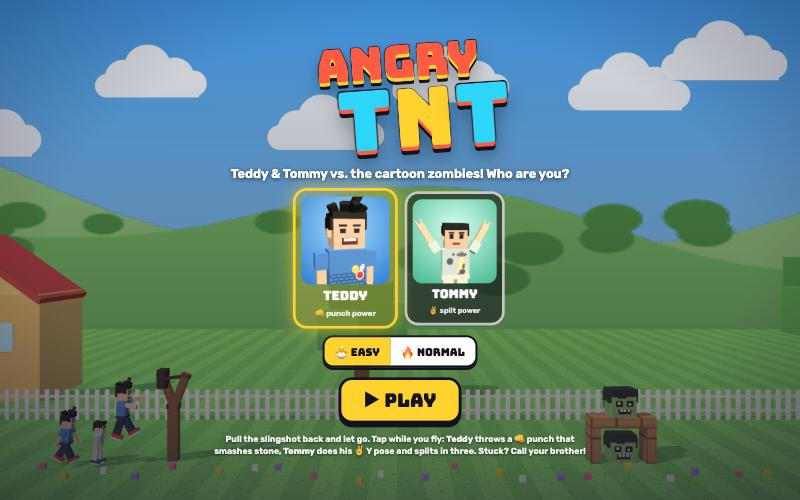

# Angry TNT

[](https://adong.github.io/angry-tnt/)

Slingshot Teddy and Tommy at wobbly zombie towers. 15 levels.

**中文：** 用弹弓把 Teddy 和 Tommy 弹向摇摇晃晃的僵尸塔。15 关。

Press **?** any time (or tap the round **?** button on the left edge) to see the keys. The game waits while you look.
Tap the language button under it (the A文 icon) to switch between English and 中文; the dashboard and every game remember the choice.

A slingshot game starring Teddy and Tommy (TNT = Teddy & Tommy). It's built with Claude Code from plain JavaScript and Three.js, on the shared Claude Games kit.
There are no image, model or audio files. The brothers come from the kit, every texture is painted on a canvas, and every sound is synthesised.
You fling the brothers, curled up into balls, at towers of wood, ice and stone that cartoon zombie heads are hiding in. A head that gets bonked pops into stars with a "BONK!". Nothing is gory or scary.
The physics is a small 2D rigid-body engine written for this game (`js/physics.js`), so towers stack without jitter, topple, and break by how hard they're hit.

## Play

- **Double-click `index.html`.** It works offline because Three.js and the kit are copied into `kit/`. Without internet, the title font falls back to Arial Black.
- **Send one file:** `dist/angry-tnt.html` is the whole game in one file, about 800 KB. AirDrop or email it, then open it in a browser.
- **Rebuild that file** after any edit: `python3 kit/tools/bundle.py . --name angry-tnt`
- Stars, best scores, the chosen brother and EASY/NORMAL are saved per browser, and separately for each way of opening the game.

On the title screen, pick who you are (**TEDDY** or **TOMMY**), then **🐣 EASY** or **🔥 NORMAL**, then **▶ PLAY** and a level.

| | Mouse | Touch | Keys |
|---|---|---|---|
| aim | press anywhere, pull back | put a finger down anywhere, pull back | Space, then ↑ ↓ (angle) and ← → (pull harder / softer) |
| launch | let go | lift your finger | Space |
| power (in flight) | click anywhere, or the big 👊 / ✌️ button | tap anywhere, or the button | Space |
| call your brother | his button (bottom right) | same | T |
| pause | ❚❚ | ❚❚ | P / Esc |
| restart | ↻ | ↻ | R |
| sound | 🔊 | 🔊 | M |
| next level (after a win) | NEXT ▶ | NEXT ▶ | Enter / N |

You can grab from anywhere, not just the slingshot. Small fingers don't have to hit a small target. Pulling only a little and letting go cancels the shot.

## How it plays

- **Your shots are the brothers.** They queue up beside the slingshot, starting with the one you picked and taking turns: TEDDY, TOMMY, TEDDY... The next one hops onto the slingshot and curls up into a ball. The faces in the top left show who's left.
- **The dotted line** shows where you'll fly. On EASY it shows the whole flight; on NORMAL only the start. The dots of your last flight stay on screen, so you can aim a little higher or lower.
- **Tap while he's flying** (before he hits anything) for his power:
  - **TEDDY: 👊 the Tyson punch.** He uncurls into a boxing straight and dashes forward, smashing straight through blocks, stone included ("SMASH!"). One punch gets through about 3 stone blocks, 6 wood or 8 ice (a bit more on EASY). The blocks next to the ones he smashes get knocked along.
  - **TOMMY: ✌️ the Y pose.** He throws both arms up in his Y with peace fingers and splits into three Tommies, each with a ✌️, fanning out up and down.
- **Blocks break by how hard they're hit.** Ice is weak and slippery, wood is medium, and stone is tough and heavy. Blocks crack before they break. Falling pieces hurt what they land on, and heads that fall off a tower pop.
- **Zombie heads** are the kit's cartoon zombie, just the head: green skin, glowing pupils, stitches. In the subway they wear backwards caps and headphones, and in the castle they wear knight helmets. The king at the end of the castle is bigger, wears a gold crown and takes more bonks. Hurt heads go dizzy and wobble.
- When a brother stops rolling he stands up, does his signature move (Teddy boxes, Tommy does his Y), and pops off in a puff.
- **You win** when every head is bonked. Every brother you didn't need jumps for a 10,000 bonus. You lose if you run out of brothers with heads left. The screen then says "SO CLOSE!" and offers to call your brother for one more shot.

### Score and stars

- Points: 5,000 per head, 500 per wood block, 300 per ice block, 800 per stone block, and 10,000 per brother you didn't need. The companion's bonus shots don't count toward that.
- ★ for clearing the level. ★★ and ★★★ come from points: clear it with one brother to spare and break about a quarter of the blocks for ★★★. The thresholds are in `create()` in `js/sim.js`.
- **EASY** blocks and heads take 35% more damage, Teddy's punch goes further, and the guide shows the whole flight. Tommy (5) should play on EASY.

## Call your brother (companion mode)

Your companion is the other brother: **Tommy** when you're Teddy, and **Teddy** when you're Tommy (`Kit.roster.buddyFor`). Call him with his big button (bottom right, with his face), or **T**, any time, as often as you like.

- He runs in from the left with a name tag, stops beside the slingshot, and says hi with his signature move: Tommy's Y with peace fingers, or Teddy's Tyson-style boxing combo.
- He throws a treat to the brother who's up next (🍦 💧 🧃 🍪 🍉 or 🍌) with a toast like "🍦 ICE CREAM FROM TOMMY!", and the brother who catches it hops for joy ("YUM!").
- **Then he hops onto the slingshot himself: a bonus shot** ("+1 SHOT! TOMMY HOPS ON!"). The brother who was loaded hops back into line. He flies with his own power, so calling Tommy gives Teddy-players a split shot, and calling Teddy gives Tommy-players a punch. If you're pulling the slingshot at that moment, he waits his turn right behind you.
- **He has your back for about 10 s.** A bar with his face under the queue shows the time left, and his button glows. If the level would be lost because you ran out of shots, he gives you one more instead: "TOMMY SAVED YOU!", and he runs back in for it. This also counts when you fired your last brother while he was there and the turn ends after he's gone.
- Tapping again while he's there throws another treat.
- When the 10 s are up he says bye ("BYE, TOMMY! 👋"). If he's still waiting in line as your shot, he waves from there; he stays your shot.
- On the **SO CLOSE!** screen the big button says "CALL TOMMY: +1 SHOT!". He comes in, says hi, and hops on, and you keep playing the same level.

## The levels

Fifteen levels in three worlds, five each. All of them are open from the start; the level select shows your stars.

| World | Levels | What's new |
|---|---|---|
| 🏡 The Backyard | 1-1 Hello, Zombies! · 1-2 Two Huts · 1-3 Ice Cream Tower · 1-4 Picnic Table · 1-5 Tree House | wood and ice, a grassy hill. A lawn, a picket fence, the house, boxy trees. |
| 🚇 The Subway | 2-1 Mind the Gap · 2-2 Turnstiles · 2-3 Train Roof · 2-4 Escalator · 2-5 Rush Hour | stone, platforms, a train roof and escalator steps. T&T Station with tiles, posters and a T&T Line train. |
| 🏰 The Castle | 3-1 Gatehouse · 3-2 Castle Wall · 3-3 The Keep · 3-4 Twin Towers · 3-5 The King's Castle | stone walls, tall towers, knight helmets and the zombie king. A sunset castle with flags. |

To add or change a level, edit `js/levels.js`. Each level is a few lines with helpers that stack from the ground up: `hut(x, y, width, height, postMaterial, beamMaterial)`, `post`, `beam`, `cube`, `pyramid`, `head(x, y, kind)` and `fixed(...)` for platforms. Then run the level check.

## How it works, and how it's tested

- **`js/physics.js`** is a 2D rigid-body engine in the style of Erin Catto's Box2D-Lite, written for this game.
  - It handles boxes and circles, with contact points clipped from box edges.
  - It uses sequential impulses with warm starting and contact feature ids, which is what keeps stacks still.
  - It also has friction, bounce, rolling resistance, island sleeping (a pile sleeps when all of it has been still for 0.5 s), and sweep-and-prune.
  - It reports the energy of every impact. That's the kinetic energy of the approach along the contact normal, using the pair's reduced mass.
- **`js/sim.js`** holds the rules: materials, damage, the shots and their powers, scoring, turns, winning and losing, and the companion's bonus shot and save. It has no Three.js in it, and the same code runs the game and the Node check.
- **`js/game.js`** only draws what the sim says and reacts to its events (breaks, pops, punches, splits...) with effects, sounds, camera moves and toasts.
- **The level check** (`node tools/check-levels.js`) runs each level twice, starting with Teddy and starting with Tommy, on NORMAL, in parallel processes. It checks three things:
  - Every level stands still on its own before the first shot.
  - A greedy bot can clear it with the shots it gives. For each shot the bot tries 20 angles × 4 pulls, with and without the power at a few points, on copies of the level, and keeps the shot that pops the most heads.
  - Every simulated turn ends within 40 s, so nothing gets stuck.

  It then plays 150 random games (random aim, random power taps), which must all end in a win or a loss with no NaN. `node tools/check-levels.js --fail` gives every level a single shot, to prove the check can fail.
- At the last run: 30/30 runs passed (the bot clears 23 runs in 1 shot and 7 in 2), 5,120 turns simulated, none stuck. In the random soak, 44 of 150 games were won, 106 lost, none stuck, and no NaN. With `--fail`, 7 of 30 runs fail, as they should.
- **Console hooks** (`window.game`), used to test in the browser, where the hidden preview pane throttles animation:

```js
game.hold(true)                       // only game.step() moves time (it keeps drawing)
game.start('2-3', { player: 'tommy', easy: true })
game.step(1.5)                        // advance 1.5 s and draw
game.aim(35, 0.8)                     // pull back at 35°, 80% (shows the guide)
game.shoot(20, 0.9)                   // fire
game.power()                          // punch / split
game.buddy()                          // call the companion
game.settle()                         // run until the turn is over
game.state()                          // phase, score, heads left, queue, companion...
game.look(24, 4, 12)                  // close-up camera; game.look() goes back
game.check(['1-1'])                   // the level check, in the page
```

## Files

```
index.html            page, HUD, menus (CSS inline)
js/title.js           the game's name, in one constant
js/physics.js         2D rigid-body engine (no Three.js)
js/sim.js             rules: materials, damage, shots, powers, score, turns, companion save (no Three.js)
js/levels.js          the 15 levels and the helpers that build them
js/solver.js          the level-check bot and the random soak (Node and browser)
js/scene.js           renderer, camera framing, the three worlds, blocks, heads, platforms, slingshot
js/fx.js              particles, block chunks, comic bursts, score popups, emoji sprites, dotted guide
js/sfx.js             sounds on top of Kit.sound
js/game.js            screens, input, camera, the brothers, the companion, HUD, window.game hooks
js/keys.js            the keys the ? panel shows (Kit.help)
js/zh.js              the 中文 words: page text, toasts, canvas words and the ? panel (Kit.lang)
tools/check-levels.js the level check (node tools/check-levels.js)
kit/                  copy of ~/claude-games/kit (python3 ../kit/tools/sync.py .), never edited here
dist/angry-tnt.html   the single-page build
```

## Kit candidates

These live in this game's own JS for now. They could move into `~/claude-games/kit` if another game wants them:

- **`ballPose(p, k)`** (`js/game.js`): curled up tight, with knees to chest, arms hugging them and chin down. It's tighter than the kit's `roll`. **`curlFit()`** measures the curled model so it fits a given ball radius.
- **A brother as a physics ball:** the root / spin / inner group split in `makeBro()`. The ball can tumble while the name tag stays upright, and the same model can stand, hop, curl and uncurl.
- **`Scene.makeHead(kind, size)`**: the zombie head on its own, facing the camera, with cap, helmet and crown variants.
- **`js/physics.js`**: the whole engine, for any game that wants stacking boxes.
- **Sounds** (`js/sfx.js`): wood / ice / stone hits and breaks, a head pop (bonk + boing + twinkle), punch, smash, split sparkle, star chimes, a win fanfare, and a gentle "oh well" for losing.
- **Effects** (`js/fx.js`): the comic starburst with a word in it, and instanced block chunks.

## Not verified

- **Sound**: the synth code runs without errors in the browser, but nobody has listened to it.
- **Real touch devices**: the drag, the tap-for-power and the buttons were tested with synthetic touch pointer events in the browser's phone (812×375, 375×812) and desktop (1280×800) sizes, not on a real iPhone or iPad. Two fingers at once is untested. Portrait works but is small, and the game shows a "turn sideways" hint.
- **Double-click from Finder (`file://`)**: the page only uses classic `<script src>` tags and makes no network requests (except the optional title font), but it was tested over `http://localhost`, because the test browser can't drive `file://` pages.
- **Difficulty for real kids**: the bot clears levels in 1–2 shots and random play wins about 30% of the time. Whether that feels right for a 5- and an 8-year-old needs Teddy and Tommy.
